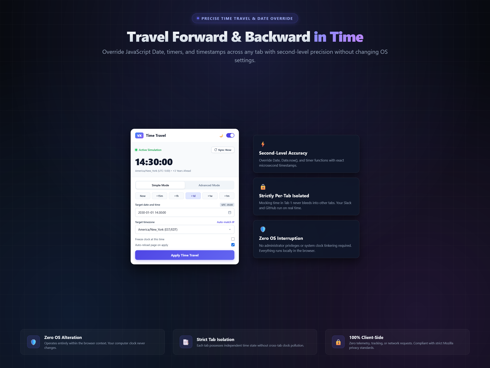
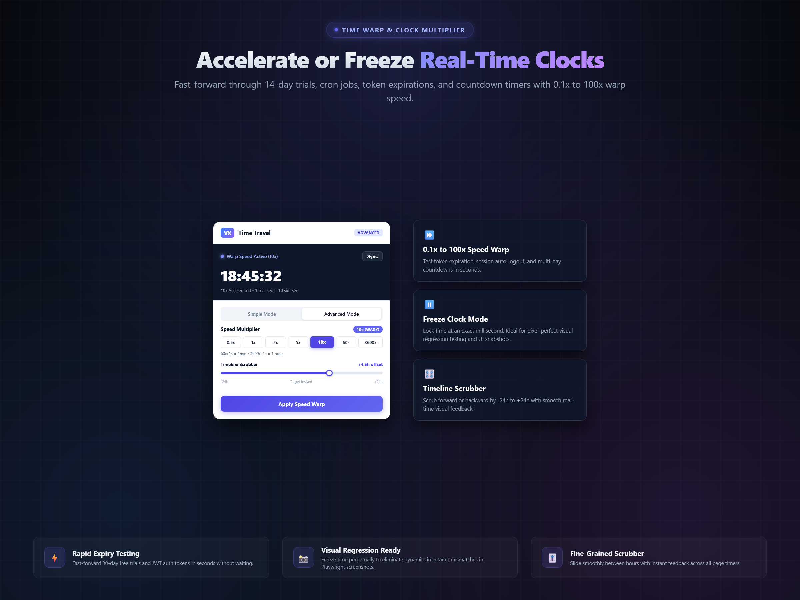
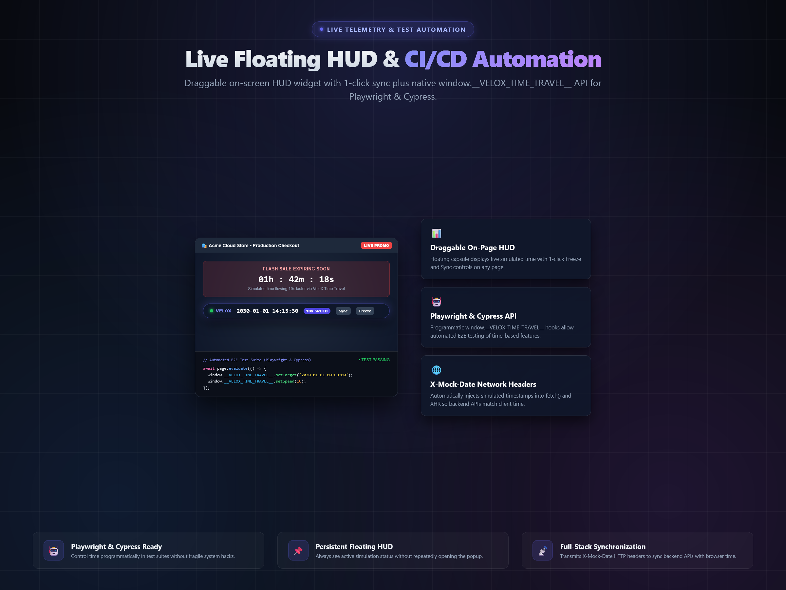
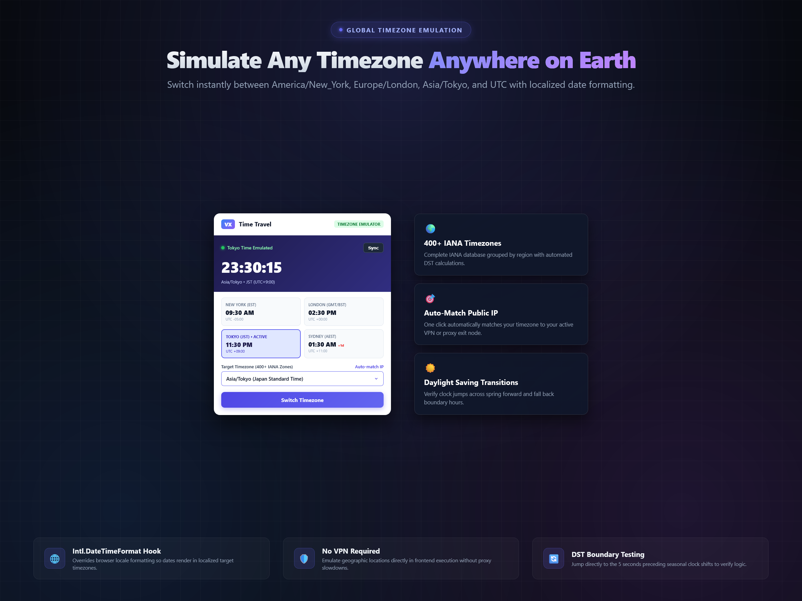
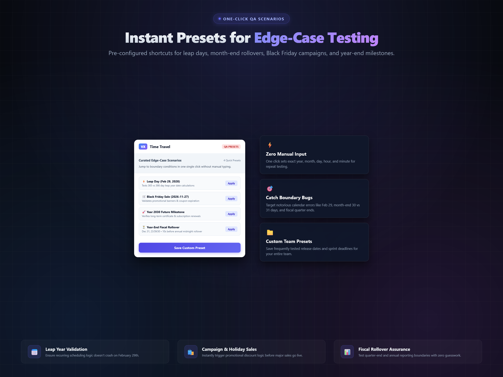

# VeloX Time Travel - Fake Date & Timezone Changer

[](LICENSE)

VeloX Time Travel overrides browser `Date`, timers, and `Intl.DateTimeFormat` APIs per tab without changing your operating system clock. It allows developers and QA testers to jump to any date/time, freeze clocks, adjust time flow speed, spoof IANA timezones, and inject mock date HTTP headers.

> 🔒 **Strictly Per-Tab Isolation**: Time travel mocking only applies to the specific browser tab where it is enabled. All other open tabs, windows, and background apps continue running on real system time without interference.

---

## Table of Contents

- [Per-Tab Isolation](#per-tab-isolation)
- [Header & Master Controls](#header--master-controls)
- [Mode Switcher: Simple vs Advanced](#mode-switcher-simple-vs-advanced)
- [Simple Mode](#simple-mode)
- [Advanced Mode](#advanced-mode)
- [In-Page Floating HUD](#in-page-floating-hud)
- [HTTP Header Injection (`X-Mock-Date`)](#http-header-injection-x-mock-date)
- [Screenshots & Interface Showcase](#-screenshots--interface-showcase)
- [Author & License](#author--license)

---

## 🔒 Per-Tab Isolation

VeloX is architected to keep your developer workflow safe and isolated:
- **Zero Cross-Tab Leakage**: Mocking a date in Tab A (e.g. testing leap-year or trial expiration) will never alter or break Tab B (e.g. Jira, GitHub, Slack, Gmail, or reference docs).
- **Independent Tab Sessions**: Each tab maintains its own independent time state. You can even test different simulated dates or speeds in two separate tabs of the same web app simultaneously.
- **Full Iframe Synchronization**: All child frames and iframes embedded inside the active tab automatically inherit the active simulated time and timezone.
- **Persists Across Page Reloads**: Refreshing or navigating within the active tab retains the mocked time until you click **Reset** or switch it off.
- **Per-Tab Toolbar Badge**: The browser action icon badge (`ON`, `PAUSE`, `60x`) reflects the state of whichever tab is currently focused. Switching to an unmocked tab clears the badge immediately.

---

## Header & Master Controls

### Header Bar
- **Theme Toggle (`☀️ / 🌙`)**: Switches the popup, sidebar, and in-page HUD between Light Mode (default) and Dark Mode. Theme preferences persist across browser sessions.
- **Master ON/OFF Switch**: Enables or disables time travel mocking for the current active tab. Switching this OFF restores real system time without clearing your configured target fields.

### Live Hero Clock Display
- **Status Indicator & Label**:
  - **System time** (gray dot): Mocking is inactive; the tab is using native device time.
  - **Active** (green dot): Time travel is active and ticking. Displays speed multiplier (e.g., `Active (60x)`) when running faster or slower than `1x`.
  - **Frozen** (amber dot): Time travel is active with the clock paused at an exact timestamp.
- **Sync Now / Reset Button**:
  - Displays **Sync Now** when mocking is inactive to populate the target date/time field with the current real timestamp.
  - Displays **Reset** when mocking is active to disable overrides and restore genuine system time.
- **Digital Readout (`HH:mm:ss`)**: Displays the live simulated time (or system time) in 24-hour format.
- **Timezone & Offset Delta**: Displays the active timezone alongside the relative offset from genuine system time (e.g., `14d 2h ahead` or `3h 15m behind`).

---

## Mode Switcher: Simple vs Advanced

- **Simple**: Focuses on setting a target date/time, picking a timezone, freezing the clock, and applying changes quickly.
- **Advanced**: Keeps all Simple Mode controls accessible at the top while revealing time-warp multipliers, timeline scrubbing, calendar presets, and developer tools underneath.

---

## Simple Mode

### Quick Nudge Buttons
One-click time shifts that adjust the target date and time:
- **`Now`**: Resets the target input to the current real-world date and time.
- **`+15m`**: Advances the target time by 15 minutes.
- **`+1h`**: Advances the target time by 1 hour.
- **`+1d`**: Advances the target time by 1 day (24 hours).
- **`+1w`**: Advances the target time by 7 days.
- **`+1m`**: Advances the target time by 30 days.

### Target Date and Time
- **Date/Time Input (`YYYY-MM-DD HH:mm:ss`)**: Manually enter any date and 24-hour time with second-level precision.
- **Local Offset Badge**: Displays the UTC offset of your selected date and timezone (e.g., `UTC+05:30` or `UTC-04:00`), automatically accounting for Daylight Saving Time.
- **Calendar Picker (`📅`)**: Opens an interactive calendar and 24-hour time selector over the popup. Clicking anywhere outside the picker automatically closes it.

### Target Timezone & Auto-Match IP
- **Timezone Dropdown**: Select `Browser System Default` or choose from canonical IANA timezones grouped by region (`America`, `Europe`, `Asia`, `Pacific`, `Africa`, `UTC`, etc.). Overriding the timezone updates `Intl.DateTimeFormat`, `toLocaleString()`, and `getTimezoneOffset()`.
- **`Auto-match IP` Button**: Queries your public IP geolocation to automatically match and select your corresponding IANA timezone (falls back to browser local timezone if offline or timed out).

### Options
- **`Freeze clock at this time`**: Locks the mocked time at the exact target second. All subsequent JavaScript date reads return the same timestamp until unfrozen or reset.
- **`Auto-reload page on apply`**: Automatically reloads the active tab after clicking **Apply time travel**, ensuring startup scripts and framework initialization evaluate using mocked time from page load.

### Actions
- **`Apply time travel`**: Activates the configured date, timezone, and freeze state on the current tab and child frames.
- **`Reset`**: Turns off mocking, reverts the tab to genuine system time, and resets the extension state to default.

---

## Advanced Mode

All options from Simple Mode remain available at the top, plus the following power tools below:

### Speed Multiplier
Control how fast simulated time moves relative to real wall-clock time:
- **`0.5x`**: Half-speed (slow motion).
- **`1x`**: Normal real-time speed.
- **`2x` / `5x` / `10x`**: Accelerated testing speeds.
- **`60x`**: **1 real second = 1 simulated minute** (useful for polling intervals, countdowns, and short session timeouts).
- **`3600x`**: **1 real second = 1 simulated hour** (useful for multi-hour or multi-day workflow simulations in seconds).

### Timeline Scrubber
- Continuous range slider spanning from **`-24h` to `+24h`** in **`0.5h`** increments.
- Scrubbing dynamically shifts the target date and time input forward or backward from your base target timestamp and displays the exact hour offset (`+6h offset`, `-3.5h offset`).

### Testing Presets
One-click scenarios that configure target timestamps, timezones, and activate time travel immediately:
- **Leap Day** (`Calendar`): Sets date to `Feb 29, 2028 12:00` for leap-year edge-case testing.
- **Year-End (New Year Eve)** (`Boundary`): Sets date to `Dec 31, 2026 23:59:50` (10 seconds before year rollover).
- **London DST Jump** (`DST`): Sets date to `Mar 29, 2026 00:59:55` in `Europe/London` (5 seconds before the 1-hour forward jump).
- **New York DST Jump** (`DST`): Sets date to `Mar 8, 2026 01:59:55` in `America/New_York` (5 seconds before the 1-hour forward jump).
- **Token Expiry (+1 Hour)** (`Auth`): Jumps 1 hour ahead from the current effective time.
- **Trial Expiry (+14 Days)** (`Billing`): Jumps 14 days ahead from the current effective time.

### Developer Tools
- **`Show floating in-page HUD`**: Displays or hides the floating on-page control capsule directly on the webpage.
- **`Inject X-Mock-Date HTTP headers`**: Automatically attaches the active simulated timestamp to outgoing network requests.
- **`Dock into browser sidebar`**: Opens the extension interface inside your browser's side panel / sidebar so controls stay open while navigating across pages.

---

## In-Page Floating HUD

When **Show floating in-page HUD** is enabled, a compact control capsule appears on the top-level webpage:
- **Badge**: Displays `Active`, `Frozen`, or the shortened simulated timezone city name.
- **Live Clock**: Displays current simulated `HH:mm:ss` time.
- **`Freeze` / `Resume`**: Quickly pause or unpause clock progression without opening the popup.
- **`Reset`**: Immediately disables mocking and restores system time.
- **Close (`×`)**: Hides the HUD from the page.
- **Draggable**: Click and drag the pill (outside of buttons) to reposition it anywhere inside the viewport. Automatically adapts to your Light or Dark theme setting.

---

## HTTP Header Injection (`X-Mock-Date`)

When **Inject X-Mock-Date HTTP headers** is enabled while time travel is active, outgoing browser `fetch()` and `XMLHttpRequest` requests include an `X-Mock-Date` header containing the ISO 8601 UTC timestamp of the simulated time:

```http
X-Mock-Date: 2027-01-01T00:00:00.000Z
```

This enables backend APIs in test or staging environments to synchronize server-side time checks with the browser's simulated clock.

---

## 📸 Screenshots & Interface Showcase

### Dashboard Overview
<p align="center">
  
</p>

### Feature Gallery

| Speed Multipliers & Time Warp | Live In-Page Floating HUD & API |
| :---: | :---: |
| <br/>**0.1x to 100x Speed Engine & Timeline Scrubber** | <br/>**Live On-Page Telemetry & Test Automation** |
| **Global Timezone Emulation** | **One-Click QA Edge-Case Presets** |
| <br/>**400+ IANA Zones & Auto-Match IP** | <br/>**Leap Day, Black Friday & Fiscal Rollovers** |

---

## Author & License

- **Author**: [Vishwas R](https://vishwas.me)
- **License**: Licensed under the [MIT License](LICENSE).
